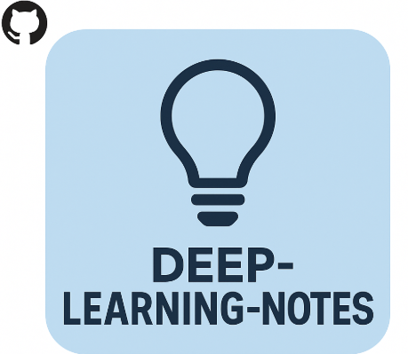

# 📘 deep-learning-notes

<p align="center">
  
</p>

<p align="center">
  <strong>全面、系统的深度学习笔记 —— 从数学基础到大模型、智能体与具身智能</strong>
</p>

<p align="center">
  <a href="https://github.com/CaoJiahao2/deep-learning-notes/actions/workflows/ci.yml"></a>
  <a href="https://caojiahao2.github.io/deep-learning-notes/"></a>
  <a href="https://github.com/CaoJiahao2/deep-learning-notes/blob/main/LICENSE"></a>
  <a href="./CONTRIBUTING.md"></a>
</p>

---

## 关于本项目

这是一套系统化的深度学习笔记，覆盖从机器学习基础理论到 2025–2026 年最新大模型技术的完整知识体系。项目旨在为深度学习学习者、研究者和工程师提供一份**结构清晰、内容详实、持续更新**的参考资料。

### 核心理念

- **体系化**：按主题域组织，而非零散堆积
- **深度优先**：每个主题包含数学推导、代码示例和参考文献
- **紧跟前沿**：持续追踪 LLM、MLLM、扩散模型、AI Agent、具身智能等最新进展
- **开源协作**：欢迎社区贡献，共同完善

---

## 📂 文档结构

全站共八大章节，每章都有 `index.md` 总览页（卡片式导航 + 学习建议），章节内部再按子主题分组。下面是节选（完整清单见 `mkdocs.yml` 的 `nav:`）：

```
docs/
├── index.md                   # 首页：知识版图 + 推荐学习路径
├── fundamentals/              # 基础理论（入门路线 / 编程算法 / 计算机系统 / 数学 / 机器学习）
│   ├── index.md               # 章节总览
│   ├── panorama.md            # 深度学习全景手册（全站总纲）
│   ├── learning-roadmap.md    # 学习路线图
│   ├── gpu-cuda.md            # GPU 架构与 CUDA 编程
│   └── math-foundations.md    # 数学基础（推导的地基）
├── architectures/             # 模型架构（主干网络 / 生成模型 / 视觉理解 / 领域应用）
│   ├── index.md               # 章节总览
│   ├── transformer.md         # Transformer 架构详解
│   ├── diffusion.md           # 扩散模型
│   └── modern-architectures.md # 现代架构演进（MoE、SSM/Mamba、高效注意力）
├── training/                  # 训练技术（训练基础 / 学习范式 / 规模化训练）
│   ├── index.md               # 章节总览
│   ├── backpropagation.md     # 反向传播完整推导
│   └── distributed.md         # 分布式训练
├── llm-mllm/                  # 大模型专题（预训练 / 后训练 / 推理扩展 / 多模态 / 评测治理 / 前沿）
│   ├── index.md               # 章节总览
│   ├── pretraining.md         # 预训练
│   ├── post-training-survey.md # 后训练综述（SFT、RLHF/DPO、GRPO）
│   └── reasoning-models.md    # 推理模型（o1/R1）
├── agents/                    # 智能体（核心机制 / 协作运行时 / 垂直领域 / 评测安全）
│   ├── index.md               # 章节总览
│   ├── fundamentals.md        # Agent 基础与核心循环
│   └── tools-and-mcp.md       # 工具使用与 MCP
├── embodied-ai/               # 具身智能（基础策略 / 数据仿真 / 世界模型评测 / 前沿应用）
│   ├── index.md               # 章节总览
│   ├── vla.md                 # VLA 模型（RT-2/OpenVLA/π0/GR00T）
│   ├── sim2real.md            # Sim-to-Real 与仿真器
│   └── papers/                # 26 篇 VLA / 世界模型论文精读
├── deployment/                # 推理部署（推理实现 / 服务化 / 压缩端侧 / LLMOps）
│   ├── index.md               # 章节总览
│   ├── inference-implementation.md # 推理实现详解（KV Cache、PagedAttention）
│   └── model-compression.md   # 模型压缩（量化、剪枝、知识蒸馏）
└── resources/                 # 资源汇总（工具命令 / 数据集 / 学习资源 / 求职 / AI4S）
    ├── index.md               # 章节总览
    ├── datasets.md            # 常用数据集
    └── learning-resources.md  # 学习资源
```

完整文档清单见 [mkdocs.yml](./mkdocs.yml) 的 `nav:` 与各章节 `index.md`。

---

## 🚀 快速开始

### 在线阅读

访问文档网站获得最佳阅读体验：<https://caojiahao2.github.io/deep-learning-notes/>

### 本地阅读

```bash
git clone https://github.com/CaoJiahao2/deep-learning-notes.git
cd deep-learning-notes
```

所有文档均为 Markdown 格式，可直接在 VS Code、Obsidian 或任何 Markdown 阅读器中查看。

### 本地预览与公式校验

项目使用 **MkDocs + Material + KaTeX** 渲染文档，数学公式在浏览器中正常显示。需要 Python ≥ 3.9 与 Node.js ≥ 18：

```bash
# 1. 安装依赖
python3 -m venv .venv && source .venv/bin/activate
pip install -r requirements.txt
npm ci        # 公式校验所需的 KaTeX（锁定版本）

# 2. 本地预览（支持公式实时渲染）
mkdocs serve

# 3. 校验公式可编译 + nav 与文档一致（CI 也会执行）
node scripts/check_math.mjs
node scripts/check_nav.mjs

# 4. 严格构建（CI 使用，任何警告都会失败）
mkdocs build --strict
```

---

## 📚 内容覆盖

| 主题域 | 内容 |
|--------|------|
| **基础理论** | 机器学习三要素、偏差-方差、过拟合/欠拟合、交叉验证 |
| **模型架构** | CNN (LeNet→ResNet→EfficientNet)、RNN/LSTM/GRU、Transformer、GAN、Diffusion、MoE/SSM/Mamba |
| **训练技术** | SGD/Adam/AdamW、学习率调度、Dropout/BN/LN、混合精度、分布式训练 |
| **强化学习与对齐** | MDP/Q-learning、PPO、RLHF、DPO、GRPO、RLVR (DeepSeek-R1) |
| **大模型** | LLM 全景调研、LoRA/QLoRA 微调、KV Cache/Flash Attention、多模态对齐 (CLIP/LLaVA) |
| **智能体** | ReAct、Function Calling/MCP、RAG 流水线、记忆机制、Multi-Agent 框架 |
| **具身智能** | VLA 模型 (RT-2/OpenVLA/π0)、Diffusion Policy、世界模型、Sim-to-Real |
| **模型部署** | ONNX、TensorRT、vLLM、量化 (GPTQ/AWQ)、剪枝、知识蒸馏、服务化部署 |
| **工具链** | Git、Conda、Docker、Linux、Tmux、常用 Python 库 |

---

## 🤝 贡献指南

我们欢迎所有形式的贡献！无论是修正笔误、补充内容、还是新增章节，都可以通过 Issue 或 PR 参与。

详细指南请参见 [CONTRIBUTING.md](./CONTRIBUTING.md)。

### 贡献者

感谢所有为本项目做出贡献的开发者！

<a href="https://github.com/CaoJiahao2/deep-learning-notes/graphs/contributors">
  
</a>

---

## 📄 许可证

本项目基于 [MIT License](./LICENSE) 开源。

---

## ⭐ Star History

如果本项目对你有帮助，欢迎 Star ⭐

<a href="https://star-history.com/#CaoJiahao2/deep-learning-notes&Date">
  
</a>

---

## 📧 联系方式

如有问题或建议，欢迎通过 GitHub Issue 交流。
