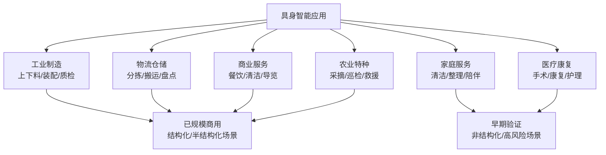

# 具身智能应用与产业版图

> 从工业制造到家庭服务，从物流仓储到医疗康复——本章梳理具身智能的落地场景、人形机器人产业格局、商业模式与真实落地挑战。

---

## 目录

1. [应用版图总览](#1)
2. [工业制造](#2)
3. [物流仓储](#3)
4. [家庭服务](#4)
5. [商业服务](#5)
6. [医疗与康复](#6)
7. [农业与特种作业](#7)
8. [人形机器人产业格局](#8)
9. [商业模式与成本结构](#9)
10. [落地挑战](#10)
11. [与自动驾驶的技术同构](#11)
12. [相关文档](#12)
13. [参考文献](#13)

---

## 1 应用版图总览 {#1}

一个实用的判据是**场景结构化程度**：

- **结构化场景**（工厂产线、仓储货架）：环境可预测、任务重复，传统工业机器人 + 少量学习组件即可落地，投资回报清晰；
- **半结构化场景**（物流分拣、商业清洁）：有一定变化，需要感知与抓取泛化，是 2020s 通用机器人的主战场；
- **非结构化场景**（家庭、野外）：长尾无限、安全要求高，依赖 VLA/基础模型的泛化能力，当前处于早期验证阶段。

---

## 2 工业制造 {#2}

### 2.1 典型任务

- **上下料与机床管理**：从料箱取件、装夹、机床上下料——视觉引导抓取（bin picking）已是成熟技术；
- **装配**：插销、拧螺丝、线缆插接——接触密集任务，需要力控 + 高精度，是 VLA 的新前沿；
- **质检与分拣**：缺陷检测（2D/3D 视觉）+ 不合格品剔除；
- **协作装配**：人与机器人共线作业（ISO/TS 15066 协作机器人安全规范）。

### 2.2 代表案例

- **Figure × BMW**：Figure 02 进入 BMW Spartanburg 工厂试点，执行钣金件插入等任务；2025 年 Helix 双系统发布后转向更通用的任务定义；
- **Agility Digit × GXO**：Digit 在 GXO 物流仓做 totes 整理（RaaS 按小时计费模式）；
- **特斯拉 Optimus**：视频展示分拣电芯、装配产线片段，目标是先服务特斯拉自有工厂；
- **传统协作机器人**（UR、FANUC、节卡、遨博）：确定性任务的存量主力，正在被加入学习组件。

### 2.3 关键指标

工业落地不看演示成功率，而看综合可用性：

| 指标 | 说明 | 工业门槛 |
|---|---|---|
| 任务成功率 | 长周期统计 | > 99.5% |
| MTBF | 平均无故障时间 | 数百小时起 |
| 节拍 | 单件循环时间 | 匹配产线（常见 < 30s） |
| 部署/换型时间 | 新 SKU 上线成本 | 小时级（学习式的核心卖点） |

---

## 3 物流仓储 {#3}

物流是"半结构化 + 强经济激励"的黄金场景：

- **包裹分拣（parcel induction）**：从混料箱中取出不规则包裹并放置到分拣口——Amazon 早在 2022 年即部署数千台该类机器人（Cardinality、Vima 相关成果）；
- **补货与拣选**：货架取放（AutoStore 类密集仓储）、订单拣选（7B 级 SKU 的长尾抓取，Covariant 的 AI 抓取方案是该赛道代表）；
- **搬运与码垛**：移动底盘 + 机械臂的复合移动操作；
- **盘点**：自主导航 + 视觉识别。

物流场景的关键特征：**任务量巨大（每天百万件级）、容错可用重试兜底、夜间空闲算力可采集数据**——是数据飞轮最容易转起来的场景。

---

## 4 家庭服务 {#4}

家庭是终极场景，也是最难的场景：

- **任务谱系**：整理桌面、收纳衣物、清洁厨房、洗衣叠衣、端茶倒水；
- **核心难点**：物品长尾（每个家都不一样）、布局变化、软体/可变形物体（衣物、线缆）、人机共处安全；
- **代表进展**：[π0.5](./papers/pi-0-5.md) 演示了“新家庭、新任务”的零样本/少样本整理能力；[π0.7](./papers/pi-0-7.md) 进一步展示复杂指代、逆向数据偏差和零样本跨实体迁移；1X Neo、智元远征等家庭人形开始限量预售/试点；Mobile ALOHA 类遥操作展示了低成本硬件做家务的可能性；
- **现实节奏**：行业普遍预期先以"特定任务套件"（如叠衣、清洁）进入家庭，再逐步扩展任务域；隐私（家中摄像头）与安全（老人儿童共处）是产品化的前置条件。

---

## 5 商业服务 {#5}

- **餐饮**：送餐机器人（普渡、擎朗已规模部署）、烹饪机器人（炒菜机自动化 + 学习式装盘）；
- **清洁**：商用清洁机器人（高仙等）覆盖地面清洁；台面整理、厨余处理仍待通用操作能力；
- **导览与接待**：展厅、政务大厅的对话 + 引导机器人；
- **酒店**：配送（云迹）+ 客房整理探索。

商业服务的共同点：**单一任务、高频重复、有人工兜底**，机器人以降本增效切入，RaaS（Robot as a Service）按月/按小时收费模式成熟。

---

## 6 医疗与康复 {#6}

- **手术机器人**：达芬奇（da Vinci）系统累计手术超千万例——主从遥操作 + 力滤波，是"人在环中最成功"的具身智能；自主手术仍处于研究阶段（STAR 系统的自主吻合实验）；
- **康复机器人**：外骨骼（Ekso、ReWalk）与康复训练机器人，学习式步态自适应是趋势；
- **护理辅助**：喂食、翻身、转移——人口老龄化的强需求，需极高安全冗余；日本 Robear、中国大艾等在推进；
- **医院物流**：药品/标本配送机器人（院内 AMR）已规模部署。

医疗场景的特殊性：**认证周期长（NMPA/FDA）、错误代价不可逆**，因此自主等级提升缓慢，"遥操作为主、自主为辅"将长期并存。

---

## 7 农业与特种作业 {#7}

### 7.1 农业

- **采摘**：草莓/苹果/番茄采摘机器人（Abundant Robotics、Septima 等）——软体抓取 + 视觉成熟度识别，遮挡与光照是难点；
- **植保与巡田**：无人机植保已高度成熟（大疆农业）；地面机器人做除草（激光除草 Carbon Robotics）、表型监测；
- **温室作业**：半结构化环境，授粉、疏果、巡检。

### 7.2 特种作业

- **电力巡检**：变电站/线路巡检机器人 + 无人机，国内已规模应用；
- **危险环境**：核电退役（Boston Dynamics Spot + 机械臂）、消防侦察、矿山作业；
- **水下与空间**：AUV 水下作业、空间站舱内操作机器人（Astrobee）、在轨服务。

特种作业的特点是**人力成本极高或风险不可接受**，对价格不敏感，是学习式机器人较早获得付费订单的场景。

---

## 8 人形机器人产业格局 {#8}

2023–2025 年人形机器人成为具身智能的产业化焦点，格局可分为四类：

### 8.1 美系公司

| 公司 | 产品 | 定位与特色 |
|---|---|---|
| Tesla | Optimus Gen 2/3 | 车厂供应链复用 + FSD 技术栈，成本目标 < $20k |
| Figure | Figure 02/03 + Helix | 自研 VLA（双系统），签约 BMW，AI 叙事最强 |
| Boston Dynamics | 电动 Atlas | 运动控制标杆转向电动 + AI，DC 模式演示 |
| Agility | Digit | 物流场景先行，RaaS 商业化最早 |
| Apptronik | Apollo | 德州系供应链，物流合作（GXO/Mercedes） |
| 1X | NEO | 家用优先、软安全设计 |

### 8.2 中国公司

| 公司 | 产品 | 特色 |
|---|---|---|
| 宇树 Unitree | H1/G1 | 运动性能标杆，G1 售价下探至 9.9 万元，开源生态强 |
| 智元机器人 | 远征 A2/灵犀 X2 | 数据（AgiBot World）+ 模型（GO-1）+ 本体垂直整合 |
| 优必选 | Walker S 系列 | 工厂场景先行（比亚迪、极氪等实训） |
| 傅利叶 | GR 系列 | 康复机器人延伸， force control 积累 |
| 银河通用 | Galbot | 抓取大模型 + 无人零售落地 |
| 星动纪元/加速进化/众擎 等 | 多款 | 裸机运动能力与价格竞争激烈 |

### 8.3 平台与生态

- **NVIDIA**：Isaac Lab / GR00T N1 / Cosmos 世界模型——"卖铲人"策略，提供仿真、基础模型与算力全家桶；
- **Google DeepMind**：Gemini Robotics + ALOHA 开源遗产 + RT 系研究，路线是"模型授权"；
- **开源硬件**：Unitree G1、Berkeley Humanoid、ARX/达妙关节模组使高校实验室进入"5–15 万元拥有人形平台"时代。

### 8.4 产业链

上游核心零部件（2025 年国产化率快速提升）：**行星滚柱丝杠、谐波/行星减速器、空心杯电机、六维力传感器、灵巧手腱绳传动、触觉皮肤**。灵巧手与触觉是当前最受关注的增量环节。

---

## 9 商业模式与成本结构 {#9}

| 模式 | 说明 | 代表 |
|---|---|---|
| 整机销售 | 一次性买断，工业客户为主 | 传统工业机器人、宇树 G1 |
| RaaS 租赁 | 按小时/月收费，含运维 | Agility（GXO 按 tote 计费） |
| 场景运营 | 直接承包产出（拣选件数等） | 仓储自动化集成商 |
| 模型/软件授权 | VLA 模型授权给本体厂 | NVIDIA GR00T、潜在 DeepMind 路线 |
| 数据/仿真平台 | 数据采集与仿真服务 | AgiBot World、Isaac 生态 |

**成本结构观察**：人形整机 BOM 中，关节模组（电机+减速+编码器）约占 50%，传感器与计算约 20%，结构约 20%。随规模爬坡，整机价格从百万元级向 20 万元级下降的曲线正在重演新能源汽车的降本路径。

---

## 10 落地挑战 {#10}

1. **可靠性鸿沟**：演示 95% 成功率 ≠ 商用——商用需要 99.9% + 异常自恢复，长尾（从未见过的物体/状态）是主要失败源；
2. **安全认证缺失**：人机共处的功能安全标准（ISO 10218/13482/TS 15066）针对传统机器人设计，学习式策略的"行为不可枚举"尚无认证方法论；
3. **数据壁垒**：真机数据采集成本高，跨公司数据共享缺乏激励，数据孤岛抑制模型迭代速度；
4. **成本与投资回报**：人形整机 + 维护成本仍高于专用自动化，ROI 需求倒逼"先做特定任务"；
5. **能耗与续航**：人形满载功率 1–2 kW，电池续航 2–4 小时，制约连续班次作业；
6. **社会接受度**：家庭摄像头隐私、就业冲击、责任界定（机器人伤人谁负责）。

**理性预期**：结构化场景（工厂/仓储）2025–2028 规模商用；商业服务 2026–2030；家庭通用服务大概率在 2030 年代逐步渗透。技术路线的不确定性仍然很高——专用机器人与通用机器人将长期共存。

---

## 11 与自动驾驶的技术同构 {#11}

自动驾驶是具身智能的"先行者"，两者高度同构：

| 维度 | 自动驾驶 | 通用机器人 |
|---|---|---|
| 问题建模 | 感知-预测-规划-控制 | 感知-推理-操作 |
| 数据飞轮 | 影子模式 + 事件回传 | 部署回传 + 遥操作纠错 |
| 长尾处理 | 仿真 reconstruct 罕见场景 | Sim + MimicGen 扩增 |
| 安全论证 | ODD 定义 + 冗余 | 任务域界定 + 兜底策略 |
| 等级划分 | L0–L5 | 遥操作 → 辅助 → 监督自主 → 完全自主 |
| 商业节奏 | Robotaxi 渐进落地 | 物流/工厂先行，家庭最后 |

从自动驾驶借来的经验：**场景界定（ODD）先于自主等级、重试与安全员兜底是规模化前提、数据基础设施先于算法竞赛**。

---

## 12 相关文档 {#12}

- 通用能力从哪里来：[VLA 模型](./vla.md)、[具身智能基础](./fundamentals.md)
- 数据基础设施：[数据集与数据采集](./data.md)
- 真实场景中的操作技术：[操作学习](./manipulation.md)
- 双系统与分层规划：[具身智能前沿专题](./frontier.md)
- 落地前的评测：[具身智能评测基准](./evaluation.md)

---

## 13 参考文献 {#13}

[1] Figure AI, *Helix: A Vision-Language-Action Model for Generalist Humanoid Robots*, 2025.

[2] Physical Intelligence, *π0.5: a Vision-Language-Action Model with Open-World Generalization*, 2025. arXiv:2504.16054.

[3] NVIDIA, *GR00T N1: An Open Foundation Model for Generalist Humanoid Robots*, 2025. arXiv:2503.14734.

[4] Agility Robotics & GXO Logistics, *Digit Warehousing Deployment Announcement*, 2024.

[5] C. Chi et al., *Universal Manipulation Interface: In-The-Wild Robot Teaching Without In-The-Wild Robots*, RSS, 2024.

[6] C. Fu et al., *Mobile ALOHA: Learning Bimanual Mobile Manipulation with Low-Cost Whole-Body Teleoperation*, 2024. arXiv:2401.02117.

[7] T. Z. Zhao et al., *ALOHA: Learning Fine-Grained Bimanual Manipulation with Low-Cost Hardware*, RSS, 2023.

[8] R. Smith, *Self-Identification, Localization, and Manipulation Capabilities of Robotic Sortation Induction Systems at Amazon*, 2022.（Amazon 包裹分拣系统公开演讲）

[9] Covariant, *AI-Powered Robot Picking Systems in Warehouse Fulfillment*, 2023.

[10] International Organization for Standardization, *ISO 10218-1/2: Industrial Robots — Safety Requirements*, 2025 revision.

[11] International Organization for Standardization, *ISO/TS 15066: Robots and Robotic Devices — Collaborative Robots*, 2016.

[12] International Organization for Standardization, *ISO 13482: Personal Care Robots — Safety Requirements*, 2014.

[13] Unitree Robotics, *Unitree G1: Humanoid Agent Development Platform*, 2024.（产品资料）

[14] 智元机器人, *AgiBot World Colosseo 与远征系列人形机器人*, 2025.（产品与技术报告）

[15] A. Mandlekar et al., *Towards General-Purpose Robots: Foundation Models and Transfer Learning*, 2023. arXiv:2304.12931.

[16] Physical Intelligence, *π0.7: a Steerable Model with Emergent Capabilities*, 2026.
