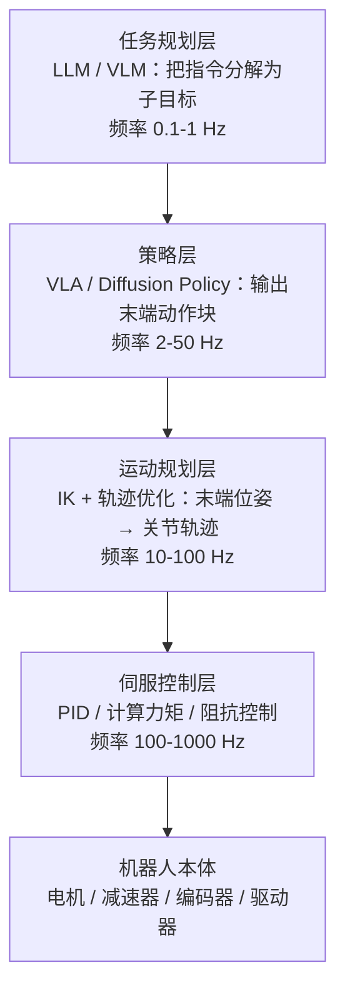

# 机器人控制与运动规划

> 学习式策略（VLA）输出的动作最终要落到关节伺服上。本章补齐"策略之下"的经典控制栈：运动学、动力学、轨迹规划、力控与全身控制，以及学习与控制的融合接口。

---

## 目录

1. [控制栈全景](#1)
2. [运动学基础](#2)
3. [动力学建模](#3)
4. [轨迹规划与运动规划](#4)
5. [模型预测控制（MPC）](#5)
6. [力控与柔顺控制](#6)
7. [全身控制与人形步态](#7)
8. [学习与控制的融合](#8)
9. [工具链](#9)
10. [实践建议](#10)
11. [相关文档](#11)
12. [参考文献](#12)

---

## 1 控制栈全景 {#1}

一个完整的具身智能系统是"学习"与"控制"的分层协作：

各层职责与频率约束：

- **越高越"智能"**：语义理解、任务分解在上层，LLM 推理慢但抽象；
- **越低越"实时"**：伺服环 1 kHz 起步，必须用确定性控制律，不能跑神经网络；
- **接口约定**：VLA 输出的 action chunk（末端位姿增量或关节目标）经低通滤波/轨迹插值后交给规划层，这是 Helix 双系统、π0 异步执行共同的工程骨架。

---

## 2 运动学基础 {#2}

### 2.1 正运动学（FK）

给定关节角 $q \in \mathbb{R}^n$，求末端位姿 $T_{end} \in SE(3)$：

$$T_{end} = A_1(q_1) A_2(q_2) \cdots A_n(q_n)$$

其中 $A_i(q_i)$ 是第 $i$ 关节的齐次变换（DH 参数或产品几何直接构造）。FK 是封闭形式、唯一映射。

### 2.2 逆运动学（IK）

给定目标末端位姿 $T^*$，求关节角 $q$：

$$q = \text{IK}(T^*), \quad \text{s.t.} \; T_{end}(q) = T^*, \; q_{min} \le q \le q_{max}$$

- **解析 IK**：六轴腕部分离构型（UR、KUKA）有封闭解，快而稳定；
- **数值 IK**：一般构型用雅可比迭代：

$$q_{k+1} = q_k + \alpha J(q_k)^{+} \, e_k$$

其中 $J(q) \in \mathbb{R}^{6 \times n}$ 是几何雅可比，$J^{+}$ 是伪逆，$e_k$ 是当前位姿误差（位置 + 姿态对数映射）。工具：Pinocchio、MuJoCo `mj_ik`、Drake、IKFast。

### 2.3 雅可比与奇异位形

雅可比把关节速度映射为末端速度：

$$v_{end} = J(q)\, \dot{q}$$

当 $J(q)$ 降秩（奇异位形，如机械臂完全伸直）时，某些方向的速度不可达，伪逆病态。工程上用阻尼最小二乘（DLS）避免爆炸：

$$\dot{q} = J^T (J J^T + \lambda^2 I)^{-1} v_{end}$$

冗余机械臂（$n > 6$，如 7 轴 Franka）还有零空间 $\dot{q}_{null} = (I - J^{+}J)\, z$，用于在跟踪末端的同时优化次要目标（避关节限位、避障、保持姿态）。

---

## 3 动力学建模 {#3}

### 3.1 拉格朗日方程

$n$ 关节机械臂的动力学标准形式：

$$M(q)\ddot{q} + C(q, \dot{q})\dot{q} + g(q) = \tau$$

- $M(q) \in \mathbb{R}^{n \times n}$：对称正定的惯性矩阵；
- $C(q, \dot{q})\dot{q}$：科氏力与离心力；
- $g(q)$：重力项；
- $\tau$：关节力矩。

### 3.2 计算力矩控制（Computed Torque）

若模型精确，可用"动力学补偿 + PD"实现精确跟踪：

$$\tau = M(q)(\ddot{q}_d + K_p e + K_d \dot{e}) + C(q,\dot{q})\dot{q} + g(q)$$

补偿后系统近似解耦为 $n$ 个线性二阶系统，$K_p, K_d$ 可按期望带宽整定。模型误差（负载变化、摩擦）会降低性能——这正是 RL/自适应控制要补的部分。

### 3.3 接触动力学

操作任务的本质是**接触**：抓取、插孔、按压都涉及不连续、非光滑的接触力。仿真中的接触模型（MuJoCo 的软约束、Isaac 的 PhysX）保真度直接决定 sim-to-real 质量；真机上，接触力估计（关节力矩 + 观测器）是力控的前提。

---

## 4 轨迹规划与运动规划 {#4}

### 4.1 采样式规划

在高维构型空间 $C_{space}$ 中搜索无碰撞路径：

- **RRT / RRT\***：快速探索随机树，概率完备；RRT\* 渐近最优；
- **PRM**：概率路线图，适合多次查询的静态环境；
- 适用：自由空间大、约束少的移动操作规划。

### 4.2 优化式规划

把路径表示为参数化轨迹 $\xi(t; \rho)$，求解带约束优化：

$$\min_{\rho} \; \int_0^T \|\ddot{\xi}(t)\|^2 dt \quad \text{s.t.} \; \xi \in C_{free}, \; q \in [q_{min}, q_{max}], \; |\dot q| \le \dot q_{max}$$

- **CHOMP / STOMP / TrajOpt**：经典轨迹优化器；
- **TOPP-RA**：时间最优参数化，给定路径求最快时间参数（工业常用后处理）；
- 适用：需要平滑、动力学可行轨迹的高精度场景。

### 4.3 学习式规划

神经网络直接生成轨迹/关键点：Motion Planning Networks（MPNet）、关键点抓取规划（PerAct/RVT 的 next-best-pose）。学习式规划的优势是"语义感知"（知道把杯子把手转到顺手方向），代价是无可行性保证——通常仍需经典校验与插值兜底。

---

## 5 模型预测控制（MPC） {#5}

MPC 在每个控制周期求解有限时域优化：

$$\min_{u_0, \dots, u_{N-1}} \; \sum_{k=0}^{N-1} \Big( x_k^T Q x_k + u_k^T R u_k \Big) + x_N^T Q_f x_N$$

$$\text{s.t.} \; x_{k+1} = f(x_k, u_k), \; x_{min} \le x_k \le x_{max}$$

滚动执行第一步 $u_0$，下一周期重新求解。特点：

- 显式处理输入/状态约束（关节限位、力矩上限），天然安全；
- 对模型误差敏感 → 常与估计器（MHE/EKF）配合；
- 求解实时性：QP 求解器（OSQP、HPIPM）+ 代码生成（CasADi、acados）可在 1 kHz 级求解小规模问题。

MPC 是腿式机器人步态控制（MIT Cheetah、宇树）的核心技术，也广泛用于机械臂的力控与避障。

---

## 6 力控与柔顺控制 {#6}

位置控制在刚性接触时等于"用很大的力砸下去"——操作任务必须柔顺。

### 6.1 阻抗控制（Impedance Control）

把末端表现为"弹簧-阻尼-质量"系统：

$$F = M_d \ddot{x} + D_d \dot{e} + K_d e$$

- $K_d \to 0$：低刚度，柔顺"软手"，适合插孔、擦拭；
- $K_d$ 大：高刚度，精确定位；
- 实现方式：关节阻抗（KUKA iiwa、Franka 原生支持）或末端六维力/力矩环。

### 6.2 导纳控制（Admittance Control）

反过来：测量力 $F_{ext}$，把力映射为位置修正 $\Delta x = F_{ext} / Z(s)$。适合位置控制精度高但无力矩传感的机器人。阻抗 vs 导纳的选择取决于硬件（有力矩传感 → 阻抗；仅位置环 → 导纳）。

### 6.3 混合力位控制

把任务空间分解为受控方向（法向力控）与自由方向（切向位置控）：打磨（法向恒力 + 切向轨迹）、插孔（法向柔顺 + 对准位置控）。

### 6.4 与学习的结合

VLA/Diffusion Policy 输出的末端轨迹默认跑在阻抗模式下执行（低刚度 + 轨迹跟踪），既能跟踪学习策略的轨迹，又保留接触柔顺性——这是当前"学习式操作"的标准工程配置。

---

## 7 全身控制与人形步态 {#7}

### 7.1 平衡与 ZMP

双足行走的经典判据是零力矩点（ZMP）落在支撑多边形内：

$$x_{zmp} = x_{com} - \frac{z_{com}\, \ddot{x}_{com}}{g + \ddot{z}_{com}}$$

基于 ZMP 的预观控制（preview control）生成质心轨迹，配合脚部落点规划实现稳定步行——ASIMO 时代的经典方法。

### 7.2 全身控制（WBC）

人形 20–40 自由度，需要同时满足：质心动力学约束、接触约束（脚不打滑、不穿透）、任务目标（行走 + 双臂操作）。WBC 把这些写成层级 QP：

$$\min_{\ddot q, f} \; \sum_i w_i \| J_i \ddot{q} + \dot{J}_i \dot{q} - \ddot{x}_i \|^2 \quad \text{s.t.} \; M \ddot{q} + h = S^T \tau + J_c^T f, \; f \in \mathcal{K}$$

其中 $\mathcal{K}$ 是摩擦锥约束。高频（1 kHz）求解，是最先进人形平台（Atlas、宇树）模型法的核心。

### 7.3 强化学习步态

2022 年后 RL 步态成为主流：在 Isaac 等 GPU 并行仿真中训练 MLP 策略（PPO），域随机化（质量、摩擦、延迟、地形）后零迁移到真机。优点是对模型误差鲁棒、地形适应性强（盲走楼梯）；缺点是可解释性与安全论证难。当前趋势是 **RL 高层 + MPC/WBC 底层** 的混合，或 RL 直接输出残差叠加在模型控制上。

---

## 8 学习与控制的融合 {#8}

| 融合模式 | 思路 | 代表 |
|---|---|---|
| 学习规划 + 控制执行 | 网络出轨迹/关键点，规划器校验插值，伺服跟踪 | PerAct → MoveIt 执行 |
| 学习残差 | 模型控制 + 网络修正项 | 残差策略学习（Johannink et al.） |
| 学习奖励 | MPC 目标函数由网络生成 | learning-based MPC |
| 策略直接输出力/阻抗 | VLA 输出轨迹 + 刚度参数 | 柔顺操作学习 |
| 双系统 | 高层语义 + 低层高频控制 | Helix（200 Hz S1）、GR00T N1 |

工程要点：

1. **接口标准化**：VLA 的 action chunk → 末端位姿/关节目标序列 → 插值 + 低通滤波 → 阻抗跟踪。延迟预算必须显式管理（感知 10–30 ms + 推理 20–200 ms + 执行）；
2. **安全过滤器**：CBF（控制屏障函数）或速度/力限幅器包在策略输出之后，保证"任何策略都安全"；
3. **重置与恢复**：失败检测（力突变、视觉异常）触发回退到安全位形，这是真机连续运行的基础。

---

## 9 工具链 {#9}

| 工具 | 定位 | 说明 |
|---|---|---|
| **MuJoCo** | 物理仿真 + IK | 接触建模精确，DeepMind 维护，MJX 支持 GPU 并行 |
| **Isaac Lab** | GPU 并行仿真 | 数千环境并行 RL，人形生态标准 |
| **Drake** | 系统级机器人软件 | 多体动力学 + 优化，MIT/Toyota 系 |
| **Pinocchio** | 刚体动力学库 | 高效 RNEA/ABA/CODEC，C++/Python |
| **MoveIt 2** | 运动规划框架 | ROS 2 生态，采样/优化规划 + 执行管理 |
| **OSQP / acados** | QP 求解器 | MPC 实时求解标配 |
| **ROS 2** | 中间件 | 实时 DDS、节点通信、仿真-真机同构接口 |

---

## 10 实践建议 {#10}

1. **先明确执行模式**：位置控制（自由空间轨迹）还是阻抗控制（接触任务）？这决定硬件选型（有无关节力矩传感）；
2. **VLA 上机前先测控制栈**：用录制轨迹回放验证跟踪精度与延迟，排除"模型差"还是"控制差"；
3. **动作空间选择**：末端 6-DoF 增量（跨本体友好、低维）vs 关节空间（灵巧手必须）——对照 [VLA 模型](./vla.md) 的动作表示一节；
4. **延迟预算表**：感知、推理、规划、执行各层延迟写进设计文档，双系统架构就是按延迟分层的结果；
5. **安全三件套**：速度/力限幅、CBF 或虚拟墙、急停与回退位形——先于任何模型指标；
6. **仿真先行**：控制参数（PD 增益、阻抗刚度）在仿真标定，再真机微调，MPC 在仿真回归测试。

---

## 11 相关文档 {#11}

- 高层策略如何产生动作：[模仿学习与策略学习](./policy-learning.md)、[VLA 模型](./vla.md)
- 步态与全身控制的仿真训练：[Sim-to-Real 与仿真器](./sim2real.md)
- 人形与灵巧操作的系统视角：[具身智能前沿专题](./frontier.md)
- 优化理论基础：[优化理论与方法](../fundamentals/optimization-theory.md)

---

## 12 参考文献 {#12}

[1] B. Siciliano et al., *Robotics: Modelling, Planning and Control*, Springer, 2009.

[2] K. M. Lynch & F. C. Park, *Modern Robotics: Mechanics, Planning, and Control*, Cambridge University Press, 2017.

[3] N. Hogan, *Impedance Control: An Approach to Manipulation*, ASME J. Dynamic Systems, Measurement, and Control, 1985.

[4] S. Kajita et al., *ZMP-based Biped Running Control* (Preview Control of ZMP), IEEE Robotics & Automation Magazine, 2003–2007.

[5] S. Kajita et al., *Introduction to Humanoid Robotics*, Springer, 2014.

[6] L. Sentis & O. Khatib, *Synthesis of Whole-Body Behaviors through Hierarchical Control of Behavioral Primitives*, IJHR, 2005.

[7] D. E. Orin, A. Goswami, S.-H. Lee, *Centroidal Dynamics of a Humanoid Robot*, Autonomous Robots, 2013.

[8] J. Kober, J. A. Bagnell, J. Peters, *Reinforcement Learning in Robotics: A Survey*, IJRR, 2013.

[9] J. Hwangbo et al., *Learning Agile and Dynamic Motor Skills for Legged Robots* (ANYmal RL), Science Robotics, 2019.

[10] G. Shi et al., *Deep Reinforcement Learning of Marked Point Trajectories for Quadrupedal Locomotion* (MPC+RL for MIT Cheetah 系), 2022–2023.

[11] A. Ames et al., *Control Barrier Functions: Theory and Applications*, ECC, 2019.

[12] T. Diegel et al., *acados: A Modular Open-Source Framework for Fast Embedded Optimal Control*, 2018–2020.

[13] R. Tedrake & the Drake Development Team, *Drake: Model-Based Design and Verification for Robotics*, 2019.
