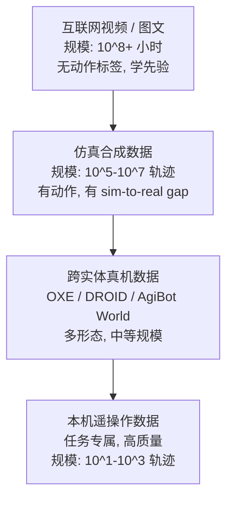
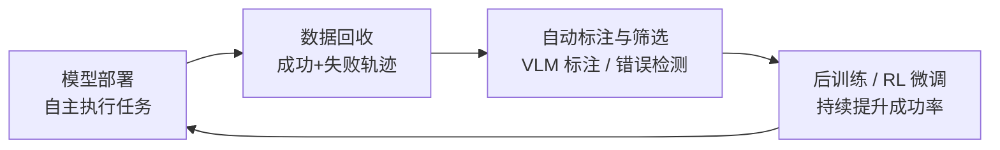

# 具身智能数据：采集、数据集、标注与数据飞轮

> 大规模、高质量、跨实体的机器人数据是 VLA / 世界模型训练的命脉。本章系统梳理数据金字塔、采集硬件、开源数据集版图、人类视频利用、数据缩放定律与数据飞轮闭环。

---

## 目录

1. [数据金字塔](#1)
2. [真机遥操作采集](#2)
3. [开源数据集版图](#3)
4. [人类视频与隐动作标注](#4)
5. [仿真数据生成](#5)
6. [数据缩放定律](#6)
7. [数据质量与语义标注](#7)
8. [数据飞轮与自改进](#8)
9. [数据工程实践](#9)
10. [相关文档](#10)
11. [参考文献](#11)

---

## 1 数据金字塔 {#1}

具身智能的数据来源呈金字塔结构：越往塔尖越接近"真实机器人动作"，规模越小、成本越高。

| 数据来源 | 真实度 | 规模 | 动作标签 | 成本 | 主要用途 |
|---|---|---|---|---|---|
| 互联网视频 | 中 | 极大 | 无 | 低 | VLM 预训练、世界模型、隐动作学习 |
| 仿真合成 | 中（有 gap） | 大 | 有 | 低（GPU 时间） | 预训练扩充、RL、域随机化 |
| 跨实体真机 | 高 | 中（10^4–10^6） | 有 | 高（共享） | VLA 通用骨干训练 |
| 本机遥操作 | 极高 | 小（10^1–10^3） | 有 | 极高（专属） | 任务后训练、专精化 |

现代 VLA 的数据配方是**四层混用**：视频学先验、仿真扩规模、跨实体学泛化、本机数据保专精（[GR00T N1](./papers/groot-n1.md) 把数据金字塔显式写进论文，[Xiaomi-Robotics-1](./papers/xiaomi-robotics-1.md) 则用 UMI 把第一层与跨实体层推向 100k+ 小时）。

---

## 2 真机遥操作采集 {#2}

人类通过主从臂、VR 手柄、外骨骼或手持装置操控机器人完成任务，同步记录关节状态、末端位姿与多视角图像，得到高质量演示。

### 2.1 主从臂平台

- **ALOHA / ALOHA 2 / Mobile ALOHA**（Stanford, 2023–2024）：低成本 3D 打印双臂主从系统，强调双手协作精细任务（拧螺丝、穿针）；Mobile ALOHA 把 ALOHA 装上移动底盘，实现全身移动双臂采集。配合 ACT 策略，数十至数百条演示即可学会精细任务，是学术圈最流行的采集范式；
- **GELLO**（2023）：低成本 3D 打印主控臂，与从臂同构、即插即用，把采集硬件成本压到数百美元级；
- ** leader-follower 经济学**：主从臂方案的瓶颈是操作员熟练度与疲劳，社区经验约为每条 30–60 秒轨迹 + 熟练操作员 20–50 条/小时。

### 2.2 手持与穿戴采集

- **[UMI](./papers/xiaomi-robotics-1.md)**（Universal Manipulation Interface, 2024）：手持夹爪 + GoPro + SLAM 定位，无需机器人本体即可采集；Xiaomi-Robotics-1 显示该路线可扩展到超过 100k 小时真实操作，并通过自动 caption 流水线两周级完成语言标注；
- **DexCap**（2024）：便携式灵巧手动捕手套，直接捕获人手高自由度动作并重定向到机器灵巧手；
- **AirExo / 外骨骼系**（2024–2025）：穿戴式外骨骼遥操作，兼顾低延迟与力反馈。

### 2.3 跨实体数据采集协议

不同实验室、不同机器人形态的数据要联合训练，必须统一：

- **统一状态空间**：关节角统一投影为末端 6-DoF 位姿 + 夹爪开合（OXE 的做法）；
- **统一时间步**：重采样到固定控制频率（典型 5–50 Hz）；
- **统一标注格式**：RLDS / LeRobot Dataset，包含观测、动作、语言标注、成功标志；
- **形态 token**：把机器人构型作为条件输入，让单模型服务多本体。

---

## 3 开源数据集版图 {#3}

### 3.1 Open X-Embodiment（RT-X, 2023）

Google DeepMind 等 21 个机构共建的里程碑数据集：

- **规模**：22 种机器人形态、约 100 万+ episodes、527 类技能 / 160266 个任务，统一 RLDS 格式；
- **贡献**：实验证明跨实体联合训练带来正向迁移——RT-X 在 OXE 上训练后，多个形态的性能超过各自单独训练；
- **地位**：Octo、OpenVLA、RDT-1B 等 VLA 的标准预训练语料。

### 3.2 DROID（2024）

Stanford、Berkeley 等 13 家机构联合的分布式采集工程：

- **规模**：564 个真实场景、86 类任务、1500+ 小时、约 8.6 万条成功轨迹（以 Franka 平台为主，多站点分布式采集）；
- **特色**：分布式多站点采集、标准化 Franka + 多相机 rig、**事后语言标注**（用 VLM 对轨迹自动生成/校正任务描述）、包含失败重试的完整 episode；
- **地位**：π0、π0.5、OpenVLA-OFT 等新一代模型的核心训练数据之一。

### 3.3 中国数据集力量（2024–2025）

- **AgiBot World**（智元）：100 台同构机器人、100+ 真实场景（工业、家庭、商业），百万级 episodes，含双臂 + 移动底盘 + 灵巧手任务；配套 Genie Sim 仿真基准；
- **RoboMind**（北银河通用等联合）：10 万+ 真机轨迹、数千任务、覆盖双臂/人形/轮式多种本体，强调中文语言标注；
- **Open6DOR / RLBench 变体**等任务级补充数据。

国产数据集的共同特点：**同构机器人批量部署 + 真实场景（非实验室）+ 中文指令**，直接服务国产 VLA（如 GO-1、UniVLA）。

### 3.4 其他重要数据集

| 数据集 | 规模/特色 | 场景 |
|---|---|---|
| BridgeData V2 | 24 环境、6 万+ 轨迹，低成本 WidowX | 桌面操作 |
| RoboNet | 15 机器人、1100+ 物体 | 桌面推动/抓取 |
| RH20T | 人类+机器人成对视频，10 万+ | 人类演示对齐 |
| Ego4D | 3670 小时第一视角人类视频 | 人类行为先验 |
| RLDS 化仿真集 | RLBench / ManiSkill / Meta-World 演示 | 仿真预训练 |

### 3.5 闭源数据

Physical Intelligence（π0）、Tesla、Figure 的数据闭源，但论文披露关键配方：π0 使用 OXE + DROID + 自有 7 种本体约 1 万小时数据；Helix 强调"少量人类遥操作 + 大量自主飞行数据"。**闭源数据规模已显著领先开源**（10 倍以上），这是当前具身智能的核心壁垒之一。

---

## 4 人类视频与隐动作标注 {#4}

互联网视频没有动作标签，如何把"人怎么做"变成"机器人怎么学"是 2024 年以来的关键课题。

### 4.1 隐动作模型（Latent Action Model, LAM）

Genie（2024）提出的思路：训练一个编码器把相邻两帧之间的"人的动作"压缩为**隐动作 token** $z_t$，再训练逆动力学/前向动力学：

$$z_t = f_\theta(o_t, o_{t+1}), \qquad \hat{o}_{t+1} = g_\theta(o_{\le t}, z_{\le t})$$

隐动作无物理单位，但捕获了"画面变化的原因"。配合少量带真机动作的数据对齐后，隐动作可映射为真实控制信号（Genie 2、GR00T 的视频预训练均采用类似思路）。

### 4.2 视频预训练到动作预测

- **GR-1 / GR-2**（ByteDance, 2023–2024）：先在 Ego4D 等大规模视频上做"帧预测"预训练，再微调为动作预测，样本效率显著提升；
- **VPT**（OpenAI, 2022）：用少量标注视频训练逆动力学模型（IDM），给海量 Minecraft 视频自动打伪动作标签，再行为克隆——"伪标签自举"范式；
- **EgoMimic / DexVLA 视频分支**：人类第一视角与机器人视角成对数据，做跨视角动作对齐。

### 4.3 局限

- 视频缺少力/触觉与机器人本体动力学信息；
- 人手 ↔ 机械夹爪/灵巧手的重定向（retargeting）有信息损失；
- 视频中的"人手"是强干扰项，需要掩码或表示学习处理。

---

## 5 仿真数据生成 {#5}

### 5.1 演示扩增

- **MimicGen**（2023）：从少量人类演示出发，依据物体位姿自动变换生成大量语义等效轨迹，可将数据扩展 10–100 倍；
- **DexMimicGen**（2025）：双臂/灵巧手版本的扩增系统；
- **RoboCasa**（2024）：程序化生成大规模厨房/家居场景 + MimicGen 扩增，产出 10 万+ 演示。

### 5.2 仿真器与并行生成

借助 GPU 并行物理仿真器（Isaac Lab、Genesis、MuJoCo MJX），单卡可并行数千环境，数小时生成百万级轨迹。优势：

- 成本低（GPU 时间 vs 人工遥操作）；
- 自动获得完美标注（关节、位姿、接触力、分割）；
- 域随机化（DOM）：随机化光照、材质、摩擦、物体形状，缩小 sim-to-real gap。

局限：物理保真度（接触、软体、流体）仍不足；视觉 gap 需要真实纹理扫描资产 + 神经渲染（3DGS 数字孪生）弥补。

### 5.3 Real-to-Sim 与数字孪生

- 用 3D 扫描 + Gaussian Splatting / NeRF 把真实场景复刻为可交互仿真场景；
- 在数字孪生中做策略预训练/评测，再迁移真机；
- 代表：SimplerEnv（真机数据的仿真复刻评测）、 Genesis、Habitat 3.0。

---

## 6 数据缩放定律 {#6}

机器人学习的 scaling 行为是 2024–2025 年的核心实证问题：

- **RT-1 / RT-2**：任务数与数据量增大 → 未见任务泛化成功率持续上升（幂律样趋势）；
- **OXE RT-X**：跨实体数据量翻倍，各实体性能普遍提升——跨实体数据不是噪声而是增益；
- **π0**：数据异质性（任务/场景多样性）比单纯轨迹数更重要；后训练阶段数百条高质量演示即可显著超越从零训练；
- **GR00T N1**：显式给出"真机 : 视频 : 仿真"三源配比消融，视频+仿真数据使同等真机预算下的性能显著提升。

**当前共识**：机器人数据同样存在 scaling 现象，但"多样性 > 数量"，且后训练数据质量权重远高于预训练。

---

## 7 数据质量与语义标注 {#7}

### 7.1 成功/失败与重试数据

- 训练 VLA 通常只用成功轨迹，但**失败与重试数据是宝贵资源**：错误检测器、恢复策略、世界模型的负样本都需要它们；
- DROID 的做法：完整保留失败-重试-成功 episode，事后标注成败边界。

### 7.2 语言标注自动化

语言指令是 VLA 的条件输入，人工标注昂贵。主流方案：

- **VLM 自动标注**：用 GPT-4V/Qwen-VL 看轨迹关键帧生成任务描述（DROID 事后标注管线）；
- **模板增强**：每条轨迹生成多个同义指令变体（"pick up the red mug" ↔ "grab the red cup"），提升语言鲁棒性；
- **人类校验**：自动标注 + 抽样人工复核的质量控制流程。

### 7.3 数据归一化与格式

- 动作归一化：不同本体的关节范围/末端速度差异巨大，需按本体统计量归一化到统一分布（否则跨实体训练发散）；
- 主流格式：**RLDS**（TF 生态、OXE 标准）、**LeRobot Dataset**（Hugging Face、社区新标准）、HDF5（ALOHA 系）、WebDataset/Parquet（大规模流式）。

---

## 8 数据飞轮与自改进 {#8}

数据飞轮是具身智能区别于静态数据集的范式：**部署越多 → 数据越多 → 模型越强 → 部署越多**。

关键组件：

1. **错误检测**：VLM 判别任务是否成功（RT-H、SuccessVQA 类方法），或用世界模型预测与实际观测的偏差检测异常；
2. **自动恢复**：失败后回退到上一个稳定状态重试（物理 reset 替代品），或训练专门的恢复策略；[π*0.6](./papers/pi-star-0-6.md) 的 RECAP 进一步把失败 rollout、人类干预与 reward 转化为 advantage-conditioned 训练信号；
3. **人类远程干预**（可选）：低成本遥操作纠错（HIL-SERL、物理智能的远程数据中心模式）；
4. **选择性训练**：只把"有信息量"的数据（失败边界、新颖场景）加入训练集，避免分布坍缩（model collapse 类比）。

Tesla FSD 的"影子模式 + 事件触发回传"是数据飞轮的成熟先例，具身智能正在复制这一工程路径。

---

## 9 数据工程实践 {#9}

### 9.1 数据清洗

- 去除无效轨迹（夹爪空抓、目标未到达、遥操作抖动）；
- 过滤异常值（关节限位、图像模糊、SLAM 漂移）；
- 演示者熟练度检查（新手演示往往拖慢收敛）。

### 9.2 数据增强

- **视觉增强**：随机裁剪、颜色抖动（注意保持物体颜色语义）；
- **空间增强**：随机平移旋转（注意任务对称性与重力方向）；
- **时序增强**：随机时间偏移（注意 action chunk 对齐）；
- **本体增强**：随机化初始关节构型，提升策略对初始状态鲁棒性。

### 9.3 数据配比与平衡

- 按任务/物体/场景做加权采样，防止高频任务淹没低频任务；
- 预训练（大配比多源数据）与后训练（小配比高质量数据）分层管理；
- 记录 data card：来源、本体、控制频率、成功率、标注方式，保证可追溯。

---

## 10 相关文档 {#10}

- 数据驱动的策略学习方法：[模仿学习与策略学习](./policy-learning.md)
- 仿真到现实的迁移：[Sim-to-Real 与仿真器](./sim2real.md)
- VLA 模型如何消费这些数据：[VLA 模型](./vla.md)
- 数据质量如何评测：[具身智能评测基准](./evaluation.md)
- 大模型数据工程通论：[大模型数据工程](../llm-mllm/data-engineering.md)

---

## 11 参考文献 {#11}

[1] Open X-Embodiment Collaboration, *Open X-Embodiment: Robotic Learning Datasets and RT-X Models*, ICRA, 2024. arXiv:2310.08864.

[2] A. Khazatsky et al., *DROID: A Large-Scale In-The-Wild Robot Manipulation Dataset*, RSS, 2024. arXiv:2403.12945.

[3] T. Z. Zhao et al., *Learning Fine-Grained Bimanual Manipulation with Low-Cost Hardware* (ALOHA/ACT), RSS, 2023.

[4] Q. Fu et al., *A Touch, Vision, and Language Dataset for Multimodal Alignment*, 2024.（Mobile ALOHA：C. Fu et al., *Mobile ALOHA*, 2024. arXiv:2401.02117）

[5] C. Chi et al., *Universal Manipulation Interface: In-The-Wild Robot Teaching Without In-The-Wild Robots*, RSS, 2024. arXiv:2402.10373.

[6] C. Wang et al., *DexCap: Scalable and Portable Mocap System for Dexterous Hand Teleoperation*, 2024.

[7] P. Wu et al., *GELLO: A General, Low-Cost, and Intuitive Teleoperation Framework*, 2023.

[8] A. Mandlekar et al., *MimicGen: A Data Generation System for Scalable Robot Learning using Human Demonstrations*, CoRL, 2023.

[9] Y. Ze et al., *DexMimicGen: Automated Data Generation for Bimanual Dexterous Manipulation*, 2024.

[10] S. Dasari et al., *RoboNet: A Large-Scale Multi-Robot Learning Benchmark*, 2019.

[11] H. Walke et al., *BridgeData V2: A Dataset for Robot Learning at Scale*, 2023.

[12] AgiBot Team, *AgiBot World Colosseo: A Large-Scale Manipulation Dataset*, 2025.

[13] X. Qi et al., *The RoboMind Open Dataset with Knowledge-Guided Learning*, 2024.

[14] D. Bruce et al., *Genie: Generative Interactive Environments* (Latent Action Model), ICML, 2024.

[15] ByteDance, *GR-2: A Video-Generative Model for General Robot Control*, 2024.

[16] OpenAI, *Video PreTraining (VPT): Learning to Act by Watching Unlabeled Online Videos*, 2022.

[17] NVIDIA, *GR00T N1: An Open Foundation Model for Generalist Humanoid Robots*, 2025.

[18] K. Black et al., *Real-Time Action Chunking with Large Models*, 2024.

[19] Xiaomi Robotics Team, *Xiaomi-Robotics-1: Scaling Vision-Language-Action Models with over 100K Hours of Real-World Trajectories*, 2026. arXiv:2607.15330.
