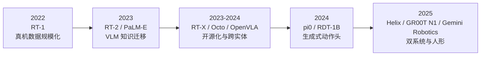

# VLA 模型：架构、动作表示与模型演进

> Vision-Language-Action 模型以预训练视觉-语言模型为骨架，把自然语言指令与视觉观测编码为条件，直接输出机器人动作。本章覆盖通用架构、动作表示、2022–2025 的完整模型演进脉络与训练范式变迁。

---

## 目录

1. [概述与定义](#1)
2. [演进时间线](#2)
3. [通用架构](#3)
4. [动作输出路线](#4)
5. [模型演进脉络（2022–2025）](#5)
6. [训练范式演进](#6)
7. [动作分块与平滑](#7)
8. [部署与效率](#8)
9. [开放问题](#9)
10. [相关文档](#10)
11. [参考文献](#11)

---

## 1 概述与定义 {#1}

VLA（Vision-Language-Action）模型是具身智能的"基础模型化"路线：把机器人策略从"每个任务训练一个专用模型"升级为"一个通用模型覆盖大量任务与机器人形态"。

形式化地，VLA 是一个条件策略：

$$\pi_\theta(a_{t:t+H} \mid o_{\le t}, \ell)$$

其中 $o_{\le t}$ 是历史视觉/本体感觉观测序列，$\ell$ 是自然语言指令，$a_{t:t+H}$ 是未来 $H$ 步动作块（action chunk）。

与 NLP 领域 GPT 系列的类比：

| NLP | 机器人 |
|---|---|
| 预训练语料（网页文本） | 机器人演示数据 + 互联网视频 |
| Transformer 解码下一个 token | 策略头解码下一个动作（chunk） |
| 指令微调（instruction tuning） | 任务后训练（post-training） |
| RLHF 对齐 | RL / 人干预微调 |

VLA 的核心承诺是：**互联网级预训练的知识（物体语义、物理常识、任务规划）可以通过 VLM 骨干迁移到机器人控制**，从而突破经典机器人学习"数据少、泛化差"的天花板。

---

## 2 演进时间线 {#2}



演进的三条主线：

1. **骨干升级**：小 Transformer → VLM → 通用多模态基础模型；
2. **动作表示升级**：离散 action token → 连续生成式动作头（Diffusion / Flow Matching）；
3. **系统结构升级**：单模型端到端 → 双系统（快慢分离）→ 分层规划。

---

## 3 通用架构 {#3}

通用 VLA 由三部分组成：

```text
   语言指令 ℓ: "把苹果放到碗里"
        │
        ▼
  ┌───────────────┐      ┌───────────────────────────┐      ┌───────────────┐
  │ 视觉编码器    │ ───▶ │   LLM backbone             │ ───▶ │ 动作输出头     │
  │ (ViT / CLIP)  │      │   (自回归 / 前馈)            │      │ (token 或连续) │
  └───────────────┘      └───────────────────────────┘      └───────────────┘
        ▲                                                    │
        │                                                    ▼
   RGB(-D) 观测                                        动作 a_{t:t+H}
```

- **视觉编码器**：常用 ViT 或 CLIP/SigLIP/DINOv2，把单目、多视角或深度图像压缩为视觉 token 序列；部分模型（SpatialVLA、DP3 系）引入点云/3D 表征增强几何感知；
- **语言模型 backbone**：通常是预训练 LLM（Llama、Gemma、Qwen），负责多模态 token 融合与高层语义推理；backbone 越强，指令理解与长程规划越强；
- **动作输出**：两条主流路线——离散化 action token / 连续动作头（详见 §4）；
- **本体感觉**：关节角度、末端位姿、力矩通常与视觉 token 拼接输入，是闭环控制的关键信号。

---

## 4 动作输出路线 {#4}

### 4.1 离散化 Action Token

把连续动作 bin 化为词表（类似语言 token），用 LLM 自回归采样：

$$a_i \in \{0, 1, \dots, K-1\}, \quad a_i \sim \pi_\theta(a_i \mid o_{\le t}, \ell, a_{<i})$$

其中 $K$ 是动作词表大小（典型 256 或 1024）。这种方式的好处是：

- 直接复用 LLM 训练与推理栈；
- 可与语言 token 联合训练（co-training），让动作与语言共享表征。

代表工作：RT-2、OpenVLA、GR00T N1 的 VLM 部分。

### 4.2 连续动作头

通过 MLP、Diffusion 或 Flow Matching 直接生成连续动作向量：

```text
方案 A：MLP 头      → a_t = MLP_θ(h_t)              （简单、快、单峰）
方案 B：Diffusion   → a_t = Sample(denoise(h_t, k))  （多峰、多步去噪）
方案 C：Flow Matching → a_t = ODE(v_θ(h_t, t), 1→0)  （多峰、少步积分）
```

代表工作：π0 / π0.5（Flow Matching）、RDT-1B（Diffusion）、ACT（CVAE+Transformer）。

### 4.3 两条路线对比

| 维度 | 离散 Action Token | 连续动作头 |
|------|-------------------|-----------|
| 精度 | 受词表粒度限制 | 任意精度 |
| 多模态分布 | 表达受限 | 天然支持多峰（Diffusion/FM） |
| 推理 | 复用 LLM 解码 | 需专用 ODE/SDE 求解器 |
| 高频控制 | 自回归逐 token 慢 | 动作块一次生成，适合分块 |
| 代表 | RT-2, OpenVLA | π0, π0.5, RDT |

**趋势**：2024 年后新模型明显倒向"LLM 骨干 + 连续生成式动作头"，兼顾语义推理与高频控制（详见 §5.4）。

---

## 5 模型演进脉络（2022–2025） {#5}

### 5.1 第一阶段：真机数据规模化 —— RT-1（2022）

RT-1（Robotics Transformer 1）是"规模化机器人学习"的开山之作：

- **数据**：13 台机器人、17 个月采集的 13 万+ 真实场景 episodes、700+ 任务；
- **架构**：EfficientNet 视觉编码 + FiLM 条件化 + Transformer 解码离散动作 token（256 bins）；
- **结论**：任务数量与数据规模越大，对没见过的任务泛化越好——验证了"机器人领域的 scaling 现象"，但真机数据成本极高，规模天花板明显。

### 5.2 第二阶段：VLM 知识迁移 —— RT-2 / PaLM-E（2023）

突破口是把动作变成"语言"：

- **RT-2**：把动作 token 与网页图文数据 **co-training**（WebLi + 机器人数据），基于 PaLI-X / PaLM-E 骨干。模型涌现出语义级泛化——能执行训练数据中没有的指令组合（"把恐龙玩具拿到恐龙图片旁边"）；
- **PaLM-E**：多模态 LLM 直接嵌入连续观测（图像、状态、场景表示），展示"具身推理链"；
- **RoboCat**（DeepMind）：跨形态、自改进闭环的代表。

这一阶段确立了 VLA 的核心信念：**VLM 的互联网知识可以迁移到机器人控制**。

### 5.3 第三阶段：开源化与跨实体 —— RT-X / Octo / OpenVLA（2023–2024）

- **Open X-Embodiment / RT-X**（2023 底）：DeepMind 联合全球 30+ 机构，把 22 种机器人形态、100 万+ episodes 统一为 RLDS 格式；RT-X 实验证明"多实体数据联合训练优于单实体单独训练"，跨实体数据呈现正向迁移；
- **Octo**（2024）：开源通用策略，Transformer 骨干 + 灵活任务头（目标图像/语言），适配不同控制频率与动作空间，是"为微调而生"的基础策略；
- **OpenVLA**（2024）：7B 参数，基于 Prismatic VLM（Llama-2 + DINOv2/SigLIP 双视觉编码器），OXE 训练，性能超过同规模闭源模型（RT-2-X 55B），且支持 LoRA 微调与量化部署，成为社区研究与二次开发的默认基座。

### 5.4 第四阶段：生成式动作头 —— π0 / RDT-1B（2024）

动作表示的关键跃迁发生在 2024 年：

- **π0**（Physical Intelligence）：VLM 骨干 + **Flow Matching 动作专家**。动作专家是一个独立的小 Transformer，在连续动作块上学习速度场，采样步数少、支持 50Hz 高频控制。π0 证明：**生成式动作头是表达多峰动作分布（同一场景多种合理做法）的正确抽象**；
- **RDT-1B**（清华）：Robotics Diffusion Transformer，1B 参数的扩散动作骨干，在多源数据上预训练，展示扩散头对灵巧操作的强拟合能力；
- **ACT / ALOHA 系**：CVAE + Transformer 的 action chunking 路线，是 Diffusion/FM 头普及前的高性价比方案，至今仍是双臂遥操作任务的主力。

### 5.5 第五阶段：双系统与人形 —— Helix / GR00T N1 / Gemini Robotics（2025）

2025 年的焦点转向**系统架构**与**人形平台**：

- **Helix**（Figure AI）：双系统 VLA——系统 2（7B VLM，7–9 Hz）负责语义理解与任务规划，系统 1（800M 快速策略，200 Hz）负责连续控制；首次在全尺寸人形机器人上实现家庭级长程任务（如整理购物）；
- **GR00T N1**（NVIDIA）：通用人形基础模型，VLM 骨干 + Diffusion Transformer 动作头；提出"真机数据 + 互联网视频 + 仿真合成"的三源数据配方与系统性数据生成管线（GR00T-Blueprints）；
- **Gemini Robotics / Gemini Robotics-ER**（Google DeepMind）：把前沿多模态模型（Gemini 2.0）与机器人控制结合，ER（Embodied Reasoning）版本专注空间理解、灵巧性与多机器人协作规划，代表"前沿大模型公司入场"的新阶段；
- **π0.5**（Physical Intelligence）：跨实体 + 层次化 + 开放世界泛化，把"知识迁移范围"从桌面操作推广到真实家庭环境（厨房清洁等）。

### 5.6 演进趋势总结

| 维度 | 2022 | 2023 | 2024 | 2025 |
|---|---|---|---|---|
| 骨干 | 小 Transformer | VLM | 开源 VLM（7B） | 前沿多模态模型 |
| 动作表示 | 离散 token | 离散 token | Flow Matching / Diffusion | 生成式头 + 分层 |
| 数据 | 单机构真机 | +互联网图文 | OXE 开源跨实体 | 真机+视频+仿真三源 |
| 系统形态 | 单模型 | 单模型 | 单模型 | 双系统 / 分层 |
| 平台 | 桌面机械臂 | 桌面机械臂 | 多形态机械臂 | 人形机器人 |

---

## 6 训练范式演进 {#6}

VLA 的训练管线正在向 NLP 的"预训练 → 后训练"靠拢：

```text
第 1 层：多模态预训练
  互联网图文/视频 + VLM 骨干（继承自 CLIP/LLM 预训练）
        │
第 2 层：机器人动作预训练
  OXE / DROID 等跨实体演示数据，联合训练动作头
  （部分工作加入互联网视频预训练：GR-1/GR-2、latent action）
        │
第 3 层：任务后训练（post-training）
  少量本机高质量演示 → LoRA / 全参微调
  或 Diffusion/FM 动作头微调（pi0 配方）
        │
第 4 层：强化学习 / 人干预微调
  HIL-SERL、PA-RL、RIPT-VLA 等在真机或仿真中继续提升成功率
```

要点：

- **预训练提供泛化，后训练提供专精**——π0.5 与 OpenVLA 的实验一致表明：小而精的后训练数据（数百条高质量演示）即可把通用模型拉到该任务 SOTA；
- **RL post-training 是 2025 年最活跃方向**：SimpleVLA-RL、PA-RL、RIPT-VLA 等把 GRPO/PPO 式 RL 引入 VLA 动作生成，在少量数据下显著提升长程成功率；
- **co-training 技巧**：动作损失与语言损失加权联合（RT-2 的做法），防止动作训练破坏语言能力（灾难性遗忘）。

---

## 7 动作分块与平滑 {#7}

为降低高频控制下的延迟与累计误差，现代 VLA 通常一次预测未来 $H$ 步动作（action chunking）：

$$a_{t:t+H} = \pi_\theta(o_t, \ell)$$

随后用执行窗口内若干步（或加平滑/低通滤波）发送给机器人。好处：

- 减少策略推理频率（50Hz 控制、2–5Hz 推理）；
- 平滑轨迹，显式建模动作间的时序耦合；
- 允许"预测-执行"异步流水线（π0 的关键工程优化）。

工程技巧：时间加权损失（前几步权重更大）、指数平滑、低通滤波、推理与执行的 chunk 重叠（temporal ensembling，ACT 首创）。

---

## 8 部署与效率 {#8}

VLA 部署的现实约束：机载算力（Jetson Orin ~275 TOPS）、功耗、延迟与安全。

| 技术 | 代表工作 | 说明 |
|---|---|---|
| 量化 | OpenVLA 4-bit（bitsandbytes） | 7B→约 4GB 显存，Jetson 可跑 |
| 骨干蒸馏 | TinyVLA、MiniVLA | 蒸馏 VLM 骨干，牺牲少量泛化 |
| 动作头加速 | OpenVLA-OFT | 并行解码 + 连续头，推理 26–40 倍加速 |
| 双系统分离 | Helix、GR00T N1 | 高频小模型 + 低频大模型，各司其职 |
| 推测解码 / KV Cache | 复用 LLM 栈 | 离散 token 路线直接受益 |

趋势判断：离散 token 路线受益于 LLM 推理优化生态（vLLM 等），连续生成头路线则靠"动作专家小模型 + 蒸馏"解决延迟；两条路线在"VLM 大脑放云端/边缘、动作小模型放机载"的混合部署上正在收敛。

---

## 9 开放问题 {#9}

1. **数据规模与多样性**：机器人数据比文本数据贵 4–6 个数量级， scaling law 形状仍不明确；
2. **长程与错误恢复**：单步成功率高不等于长程能跑通，任务级规划与失败检测仍在早期；
3. **触觉与力觉融合**：绝大多数 VLA 只吃视觉，接触密集任务（插销、打结）上限受限；
4. **安全与可验证性**：黑箱策略在物理世界的安全认证（ISO 10218 等）尚无方法论；
5. **评测**：真机评测不可复现、仿真评测有 gap，标准化评测基础设施仍是最稀缺资源。

---

## 10 相关文档 {#10}

- 全领域技术时间线：[技术演进史 2012-2025](../fundamentals/tech-evolution.md)
- 数据从哪里来：[数据集与数据采集](./data.md)
- 策略学习方法（BC / Diffusion Policy / RL）：[模仿学习与策略学习](./policy-learning.md)
- 动作如何落到关节：[机器人控制与运动规划](./control.md)
- 双系统与分层规划细节：[具身智能前沿专题](./frontier.md)
- 基准与评测协议：[具身智能评测基准](./evaluation.md)
- 应用与产业落地：[具身智能应用与产业版图](./applications.md)

---

## 11 参考文献 {#11}

[1] A. Brohan et al., *RT-1: Robotics Transformer for Real-World Control at Scale*, CoRL, 2022. arXiv:2212.06817.

[2] A. Brohan et al., *RT-2: Vision-Language-Action Models Transfer Web Knowledge to Robotic Control*, CoRL, 2023. arXiv:2307.15818.

[3] D. Driess et al., *PaLM-E: An Embodied Multimodal Language Model*, ICML, 2023.

[4] Open X-Embodiment Collaboration, *Open X-Embodiment: Robotic Learning Datasets and RT-X Models*, ICRA, 2024. arXiv:2310.08864.

[5] Octo Team, *Octo: An Open-Source Generalist Robot Policy*, RSS, 2024.

[6] M. J. Kim et al., *OpenVLA: An Open-Source Vision-Language-Action Model*, CoRL, 2024. arXiv:2406.09246.

[7] Physical Intelligence, *π0: A Vision-Language-Action Flow Model for General Robot Control*, 2024. arXiv:2410.24164.

[8] Physical Intelligence, *π0.5: Open-World Generalist Robot Policy*, 2025. arXiv:2504.16054.

[9] Figure AI, *Helix: A Vision-Language-Action Model for Generalist Humanoid Robots*, 2025.

[10] NVIDIA, *GR00T N1: An Open Foundation Model for Generalist Humanoid Robots*, 2025. arXiv:2503.14734.

[11] Google DeepMind, *Gemini Robotics: Bringing AI into the Physical World*, 2025.

[12] X. Liu et al., *RDT-1B: A Diffusion Foundation Model for Bimanual Manipulation*, 2024. arXiv:2410.07864.

[13] T. Z. Zhao et al., *Learning Fine-Grained Bimanual Manipulation with Low-Cost Hardware* (ACT/ALOHA), RSS, 2023.

[14] K. Black et al., *Real-Time Action Chunking with Large Models* (OpenVLA-OFT / pi0-style async), 2024.

[15] D. Qu et al., *SpatialVLA: Exploring Spatial Representations for Vision-Language-Action Models*, 2025.

[16] J. Luo et al., *HIL-SERL: Human-in-the-Loop Sample-Efficient Reinforcement Learning for Robot Manipulation*, 2024.
